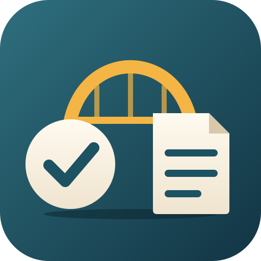

<p align="center">
  
</p>

<h1 align="center">OmniFocus Bridge</h1>

<p align="center">
  <em>Bidirectional sync between OmniFocus 4 Pro and Obsidian.</em>
</p>

<p align="center">
  
  
  
  
</p>

---

An [Obsidian](https://obsidian.md) plugin that mirrors your OmniFocus projects, tasks, and tags into your vault as markdown, and writes completions, flags, and dates back to OmniFocus.

## Features

- **One-way sync**: OmniFocus to Obsidian -- projects, tasks, and tags with full folder hierarchy
- **Write-back**: Complete tasks, toggle flags, set due/defer dates directly from Obsidian
- **Quick Add**: Create new OmniFocus tasks without leaving Obsidian
- **Side panel**: An OmniFocus view with Today, Inbox, Projects, and Dashboard tabs
- **Auto-sync**: Configurable interval (1m / 5m / 15m / 30m), plus sync on startup and on file open
- **Incremental sync**: Only updates changed projects, keeping syncs fast
- **Dashboard**: Auto-generated overview with overdue, due today, due this week, and flagged sections
- **Daily Note integration**: Insert a daily task summary at the cursor position
- **Codeblock views**: Use `omnifocus` fenced code blocks for filtered, live task views
- **Rich rendering**: Emoji metadata, sorted tasks, frontmatter compatible with Dataview

## Requirements

- **macOS** (the plugin uses OmniFocus's Automation API via `osascript`)
- **OmniFocus 4 Pro** (the Pro edition is required for JavaScript automation)
- **Obsidian Desktop** (v1.0.0 or later)

## Installation

> OmniFocus Bridge is **not yet in the Obsidian Community plugins directory** (submission pending), so searching for it inside Obsidian won't find it yet. Install it from a release instead.

### Install from a release

1. Download `main.js`, `manifest.json`, and `styles.css` from the [latest release](https://github.com/XyndoX/omnifocus-sync/releases/latest)
2. Create a folder called `omnifocus-bridge` inside your vault's `.obsidian/plugins/` directory
3. Copy the downloaded files into that folder
4. Restart Obsidian and enable **OmniFocus Bridge** in **Settings > Community plugins** (turn off Restricted mode first if it's on)

### Build from source

Requires [Node.js](https://nodejs.org) and git.

```bash
git clone https://github.com/XyndoX/omnifocus-sync.git
cd omnifocus-sync
npm install
npm run build
```

Then copy `main.js`, `manifest.json`, and `styles.css` from the repo root into `<vault>/.obsidian/plugins/omnifocus-bridge/` and enable the plugin as above.

## Usage

### First Sync

1. Open **Settings > OmniFocus Bridge**
2. Click **Test Connection** to verify OmniFocus is running and accessible
3. Click **Sync now** or use `Cmd+P` and search for **OmniFocus Bridge: Sync now**

Your OmniFocus projects will appear as markdown files inside the sync folder (default: `OmniFocus/`).

### Commands

Open the command palette (`Cmd+P`) and search for any of the following:

| Command | Description |
|---------|-------------|
| **Sync now** | Pull latest data from OmniFocus and update markdown files |
| **Open sync folder** | Open the dashboard (or the first note) in the sync folder |
| **Open panel** | Open the OmniFocus side panel (Today, Inbox, Projects, Dashboard) |
| **Generate dashboard** | Create or update `Dashboard.md` with overdue, due today, due this week, and flagged task sections |
| **Quick add task** | Open a modal to create a new task in OmniFocus (auto-detects project from current file) |
| **Complete/reopen task** | Toggle the completion state of the task on the current line |
| **Toggle flag** | Flag or unflag the task on the current line |
| **Set due date** | Set or clear the due date for the task on the current line |
| **Set defer date** | Set or clear the defer date for the task on the current line |
| **Open task in OmniFocus** | Open the task on the current line directly in OmniFocus |
| **Insert daily summary** | Insert a summary of today's due, overdue, and flagged tasks at the cursor |

### Codeblock Views

Add an `omnifocus` fenced code block to any note for a live, filtered task view:

````markdown
```omnifocus
view: due-today
```
````

#### Available Views

| View | Description |
|------|-------------|
| `all-active` | All incomplete tasks (default) |
| `due-today` | Tasks due today or overdue |
| `due-this-week` | Tasks due within the next 7 days |
| `flagged` | Flagged tasks only |
| `project` | Tasks from a specific project (requires `project:` parameter) |

#### Options

| Option | Values | Default | Description |
|--------|--------|---------|-------------|
| `view` | see above | `all-active` | Which tasks to display |
| `format` | `list`, `table` | `list` | Render as checkbox list or HTML table |
| `show` | comma-separated columns | `name,dueDate,project,tags` | Columns to show in table format |
| `project` | project name | -- | Filter to a specific project (used with `view: project`) |

Valid columns for `show`: `name`, `dueDate`, `deferDate`, `project`, `tags`, `estimate`, `flagged`.

#### Examples

**Flagged tasks as a table:**

````markdown
```omnifocus
view: flagged
format: table
show: name, dueDate, project
```
````

**Tasks from a specific project:**

````markdown
```omnifocus
view: project
project: Home Renovation
```
````

### Settings

| Setting | Description | Default |
|---------|-------------|---------|
| **Sync folder** | Vault folder where OmniFocus data is stored | `OmniFocus` |
| **Tag prefix** | Prefix for OmniFocus tags (e.g., `#of/TagName`) | `of` |
| **Sync interval** | Auto-sync frequency: Manual, 1m, 5m, 15m, or 30m | Manual |
| **Sync on startup** | Automatically sync when Obsidian starts | Off |
| **Show due date** | Display due dates on task lines | On |
| **Show tags** | Display OmniFocus tags on task lines | On |
| **Show time estimate** | Display estimated time on task lines | On |
| **Show OmniFocus link** | Add a deep link that opens the task in OmniFocus | Off |

## How It Works

The plugin communicates with OmniFocus through its JavaScript for Automation (JXA) API via macOS `osascript`. It reads projects, tasks, and tags from OmniFocus, then writes them as markdown files with frontmatter metadata into your vault. Checkbox changes in the synced files are detected and written back to OmniFocus automatically.

Each task line includes an invisible HTML comment anchor (`<!-- of:taskId -->`) that links the markdown checkbox to its OmniFocus counterpart.

## FAQ

**Q: Does this work on Windows, Linux, or mobile?**
A: No. OmniFocus is macOS/iOS only, and the plugin requires macOS Desktop for its Automation API. On other platforms, the plugin loads but gracefully disables itself with a notice.

**Q: Do I need OmniFocus Pro?**
A: Yes. The free and Standard editions do not support the JavaScript automation API that this plugin uses.

**Q: What happens if OmniFocus is not running?**
A: The plugin will show a clear error message asking you to open OmniFocus. No data is lost.

**Q: Is OmniFocus the source of truth?**
A: Yes. OmniFocus owns the project structure, task creation, and most metadata. The plugin syncs that structure into Obsidian. You can complete tasks, toggle flags, and set dates from Obsidian, and those changes are written back immediately.

**Q: Can I use this with Dataview?**
A: Yes. Every synced file includes frontmatter fields (`omnifocus-project-id`, `omnifocus-status`, `omnifocus-last-sync`) that Dataview can query.

## License

MIT
